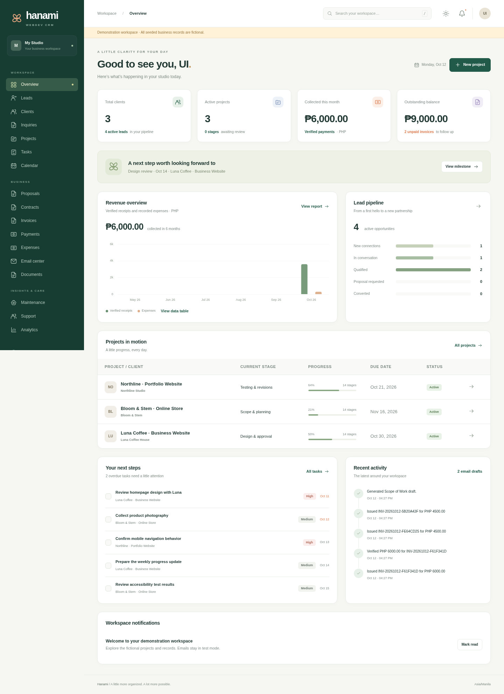

# Hanami · WebDev CRM

WebDev CRM is a locally hosted Flask application for managing website development clients from the first inquiry through delivery and maintenance. It connects leads, clients, projects, tasks, pricing, payments, documents, email, QA, launch records, and support in one SQLite database.

The interface supports desktop and mobile layouts, light and dark themes, search, dashboards, calendar views, and CSV/PDF exports. Human decisions remain explicit: an email send does not accept a proposal, a reported payment does not verify it, and a checked checklist does not authorize a launch.

This guide covers installation, first use, the full project workflow, solo and small-team routines, and ongoing maintenance. The [user guide](docs/user-guide.md) explains the workflows in more detail; [deployment and operations](docs/deployment.md) covers hosting, SMTP, and recovery. The [validation record](docs/validation.md) lists the checks performed and integration limits. The original [requirements](docs/requirements.md) and [architecture](docs/architecture.md) are included for reference.



## 1. Install and start your workspace

### Step 1 — Install prerequisites and get the repository

Use Git and Python 3.12 or a compatible supported Python version. Linux and macOS support both the web application and scheduler. On Windows, use WSL for the complete workflow: the dedicated scheduler uses a POSIX process lock. Native Windows can run the web application, but the scheduler must run in a compatible environment against the same instance; WSL for both processes is simpler.

```bash
git clone https://github.com/khaiyenIsCanadianHam/Hanami.git
cd Hanami
```

If the cloud environment already contains this repository, open its existing checkout. Each cloud task already has an isolated environment; do not create another Git worktree unless you specifically need one.

### Step 2 — Create and activate a virtual environment

Linux, macOS, or WSL:

```bash
python3 -m venv .venv
source .venv/bin/activate
```

Windows PowerShell for the web application:

```powershell
py -3.12 -m venv .venv
.venv\Scripts\Activate.ps1
```

If PowerShell blocks activation, use `.venv\Scripts\python.exe` and `.venv\Scripts\flask.exe` directly instead of weakening a machine-wide execution policy.

Install the application and development checks:

```bash
python -m pip install -r requirements-dev.txt
```

On Linux, macOS, or WSL, `bash scripts/setup.sh` repeats dependency installation, migrations, and template initialization safely. It never creates a default account or inserts demonstration records.

For a runtime-only installation, use `requirements.txt` instead. Dependencies are pinned. ReportLab generates PDF documents without requiring a separate HTML renderer; a system DejaVu Sans font improves Unicode coverage.

### Step 3 — Create private environment configuration

Linux, macOS, or WSL:

```bash
cp .env.example .env
```

Windows PowerShell:

```powershell
Copy-Item .env.example .env
```

Open `.env` in your editor. For local development, these defaults are appropriate:

```dotenv
APP_ENV=development
DATABASE_URL=sqlite:///webdev_crm.sqlite3
BUSINESS_TIMEZONE=Asia/Manila
DEFAULT_CURRENCY=PHP
SESSION_COOKIE_SECURE=false
EMAIL_TEST_MODE=true
AUTOMATIONS_PAUSED=false
```

Generate a stable session secret and place its output in `SECRET_KEY` locally:

```bash
python -c "import secrets; print(secrets.token_hex(32))"
```

Development can create a private persisted key if `SECRET_KEY` is blank; production requires an explicit key of at least 32 characters. Keep `.env`, the database, uploads, exports, and backups private and outside version control. Never store SMTP credentials or client passwords in CRM notes or source code.

### Step 4 — Create the schema and default templates

```bash
flask --app run:create_app db upgrade
flask --app run:create_app seed-templates
```

The default SQLite database is `instance/webdev_crm.sqlite3`. A relative SQLite URL resolves inside Flask's instance directory. `seed-templates` installs missing email and document templates without replacing your edited templates.

Use migrations for an existing installation. The `init-db` convenience command is restricted to development and does not replace migration management.

### Step 5 — Create your administrator account

```bash
flask --app run:create_app create-admin --email you@example.com --name "Your Name"
```

Replace the sample email with your own. Enter and confirm a password of at least twelve characters when prompted. There is no default login or shared built-in password. For controlled unattended provisioning, securely inject `ADMIN_PASSWORD`; do not commit its value or paste it into shared documentation.

### Step 6 — Start the web application and sign in

```bash
flask --app run:create_app run --host 127.0.0.1 --port 5000
```

Open <http://127.0.0.1:5000> and sign in. Keep this terminal running. Use **Settings** to review business details, currency, timezone, and email/automation preferences before creating real records. The development server is for local use; shared hosting instructions appear below.

### Step 7 — Start the scheduler in a separate terminal

Open another terminal in the same repository, activate the same virtual environment, and run:

```bash
source .venv/bin/activate
python -m scheduler
```

Run exactly one scheduler for the instance. It processes durable scheduled work and approved email queues separately from the web server. Nothing executes while its process or machine is off. Keep it under a service manager for dependable 24/7 operation. Use `Ctrl+C` to stop either foreground process cleanly.

### Step 8 — Optionally explore fictional demonstration data

With `APP_ENV=development`, an administrator already created, and an empty business database:

```bash
flask --app run:create_app seed-demo
```

The demonstration workspace includes Luna Coffee House and other fictional businesses, project stages, tasks, proposals, invoices, verified example payments, documents, drafts, and maintenance examples. It displays a demonstration banner and keeps email in test mode.

Use a separate database for evaluation. To create one, set `DATABASE_URL=sqlite:///demo.sqlite3` in a separate local configuration, then repeat migration, template, and administrator setup before seeding. Avoid changing the live instance's database URL while either process is running. Do not seed a database containing real business data.

### Step 9 — Run the checks

```bash
pytest -q
ruff check app tests scheduler run.py
```

Tests use isolated databases and simulated or mocked SMTP. They include a fictional lead-to-handover journey, approval/payment gates, negative authorization and upload checks, financial calculations, automation, and recovery behavior. Do not use a production database for development tests.

## 2. Complete a website project, step by step

Start in **Leads**. Record the contact, business, source, service, budget, desired date, notes, and follow-up. Qualification work and an email draft are prepared for review. Qualify the opportunity and deliberately confirm **Convert to client**. The original lead relationship and associated information remain available. Open the client to maintain contacts and create its project.

Each project has fourteen stages. Open its lifecycle timeline, save the required fields, complete each required checklist or document a specific exception, record approval with the decision-maker and evidence, and choose **Complete stage**. Read the blocker list if progression is refused. Review substantive approvals separately from general stage approval.

| Step | Workspace and actions | Completion evidence |
| --- | --- | --- |
| 1. Acquisition | Create and qualify the lead; confirm conversion. | Qualification, requested service, and conversion review. |
| 2. Inquiry | Create the associated inquiry; answer the questionnaire. | Website type, audience, features, budget, and reviewed information. |
| 3. Discovery | Record consultations, objectives, constraints, decisions, and unresolved questions. | Administrator-reviewed requirements summary. |
| 4. Scope and planning | Add included/excluded features, hours, rates, dependencies, acceptance criteria, and milestones. | Separate explicit scope approval. |
| 5. Proposal | Generate or build the quotation, review totals, export PDF, revise as needed, and record client acceptance. | Reviewed proposal and acceptance evidence confirmed by the administrator. |
| 6. Contract and deposit | Generate and review the contract; record execution; issue the deposit invoice; record and independently verify its payment. | Executed agreement and settled deposit invoice. |
| 7. Onboarding | Collect logos, content, media, brand details, and delegated account access. | Critical materials present or evidenced exceptions. |
| 8. Design | Submit versioned design references; record revisions and feedback; approve the actual version. | Explicit design approval. |
| 9. Development | Track scope tasks and dependencies on the development board, update hours, and record staging/repository references. | Required development tasks completed and features ready for QA. |
| 10. QA and revisions | Create test cases or seed the standard set; record executions; track and retest defects. | Required tests passed and release-blocking bugs resolved. |
| 11. Acceptance and payment | Record written final acceptance, issue the final invoice or reconcile a fully paid upfront schedule, and verify remaining payments. | Verified final acceptance and settled commercial obligations. |
| 12. Launch | Separately authorize launch, document the external deployment, confirm production checks, and record rollback/backup evidence. | Completed deployment record with explicit authorization. |
| 13. Handover | Deliver documentation, transfer account ownership securely, record training and client receipt, and explain warranty terms. | Confirmed handover deliverables. |
| 14. Maintenance and support | Record a maintenance agreement or explicit decline, renewal dates, and support expectations. | Recorded maintenance decision; project lifecycle completed. |

Use **Return to stage** with a reason when earlier work changes. Later completion is invalidated and fresh approvals are required, while history remains intact. Pause or cancel a project deliberately. Reopening an agreed scope is different from silently editing a finalized document or issued invoice.

### Everyday feature reference

| Feature | How to use it |
| --- | --- |
| Clients and contacts | Open **Clients**, maintain business/contact details, add related contacts, and inspect projects and activity. Archive instead of discarding operational history. |
| Tasks and development board | Create tasks with priority, due dates, estimates, and dependencies; update their status as work progresses. Resolve prerequisite tasks before completing dependent work. |
| Calendar | Review tasks, milestones, and meetings by their scheduled dates. Enter dates on the underlying records to populate the calendar. |
| Scope and milestones | Record included/excluded work with acceptance criteria. Estimates support planning; they do not guarantee actual completion dates. |
| Proposals | Build itemized labor/fixed/expense pricing with tax, contingency, and discounts. Review recurring costs separately, export, and record accepted versions. |
| Contracts | Generate from an accepted proposal, customize and professionally review the draft, then record signed evidence. The application does not supply an electronic-signature service. |
| Invoices and payments | Review and issue invoices, record reported payments, and separately verify against independent evidence. Only verified amounts reduce balances. Preserve finalized amounts and use documented corrections. |
| Expenses | Record project costs to support financial review. The CRM is an operational system rather than a complete accounting/tax package. |
| Email Center | Create or generate a draft, review recipient and content, approve, queue, and inspect the outcome. Test mode produces a labeled simulation. |
| Email/document templates | Edit approved wording in each Templates workspace. Use the supported literal placeholders shown in the interface; template expressions are rejected. |
| Documents and files | Generate project documents, retain revisions, export PDFs, and upload permitted supporting files. Downloads require authentication. |
| Design revisions and change requests | Record feedback against its design version; assess scope, cost, and time impact before approving billable changes. |
| QA and bug tracking | Record steps, expected/actual results, tester, evidence, and severity. Resolve blockers and record passing retests. |
| Training and handover | Schedule training, record completion or an evidenced waiver, and keep the delivered documentation and ownership-transfer evidence. |
| Maintenance | Define service scope, recurring fee, renewal date, and support expectations; review generated maintenance work and draft renewal invoices. |
| Support tickets | Record the issue, priority, assignee, investigation, time, status, and resolution evidence. |
| Search and analytics | Search business records; review live dashboard metrics, filtered analytics, and CSV exports. Protect exported personal/commercial data. |
| Settings and automations | Configure business preferences, review rules and job status, and pause scheduled automation when needed. Approval requirements still apply. |

The development progress percentage measures completed estimated task hours. It is separate from lifecycle approval and release readiness. All dates are stored in UTC and displayed using the configured business timezone, defaulting to Asia/Manila. Financial calculations use Decimal amounts.

## 3. A practical routine for a solo developer

1. At the start of the day, open the dashboard and calendar. Review overdue tasks, follow-ups, approaching milestones, outstanding invoices, pending approvals, and email drafts.
2. Qualify new leads and schedule the next action. Draft personalized communication, review it, and approve only the messages you intend to send.
3. Open each active project's current stage. Work through its blockers, update task status and actual hours, and record decisions while their context is fresh.
4. Record money when reported, then verify it against a bank/provider record. Keep this independent check even when you are the only operator.
5. Before ending the day, review failed or uncertain email outcomes and scheduler status. Capture notes, next actions, and a protected backup according to your retention plan.
6. Weekly, review financial summaries, maintenance renewals, stale leads, project scope changes, and upcoming client approvals. Periodically restore a backup into a separate instance to check recovery.

## 4. Use with a small team

The first release has administrator authorization. You may provision a separate named administrator account for each trusted operator using `create-admin`, but **every administrator can access and change all business records**. There are no granular project permissions, read-only client accounts, or customer portal. The model's role field is groundwork for future access control; non-administrator roles do not enable supported team workflows.

For a small trusted team:

1. Choose one centrally hosted instance, one shared database, and one dedicated scheduler. Do not circulate independent SQLite copies and attempt to merge them.
2. Create individual named administrator accounts. Do not share a single password; audit and approval records are more useful when actions identify their operator.
3. Agree who owns each client, task, consultation action, and approval review. Use task assignment where provided and explicit owners in meeting notes and support records. Include an owner and date in operational notes when no dedicated assignment field applies.
4. Agree who may approve commercial terms, verify payments, authorize launches, and communicate with clients. These are team conventions in this release, not separately enforced permission roles.
5. Use task status, dependencies, milestones, stage history, and evidence to hand work between people. Avoid simultaneously editing the same record; refresh before saving important changes.
6. Let one responsible operator handle migrations, backups, restore drills, and SMTP changes. Pause the team and scheduler for maintenance windows.

For account recovery or offboarding, run these from a trusted operator terminal with the application environment loaded:

```bash
flask --app run:create_app reset-password --email teammate@example.com
flask --app run:create_app set-user-active --email teammate@example.com --inactive
```

Password reset prompts securely and invalidates existing sessions on their next request. Deactivation denies existing sessions as well; the command prevents disabling the last active administrator. Use `--active` to reactivate a reviewed account. Restrict shell access because these are privileged operator commands.

For stronger access separation, a larger concurrent team, or multi-host deployment, add and test granular authorization and a suitable production database/infrastructure design before expanding access. The current SQLite application is best suited to one instance with modest write concurrency.

## 5. Configure email safely

Email defaults to test mode. First create a harmless draft to your own address, approve it, queue it, run the scheduler, and confirm that its outcome is **simulated**. This verifies the local review/queue workflow without contacting SMTP.

For live sending:

1. Privately set `SMTP_HOST`, `SMTP_PORT`, `SMTP_USER`, and `SMTP_PASSWORD` in the environment. Gmail-compatible defaults use `smtp.gmail.com:465` with TLS; use your provider's supported application credential.
2. Set `EMAIL_TEST_MODE=false` in the environment and disable test mode in the application's email settings. Both controls must allow live mode. Restart the web and scheduler processes to load environment changes.
3. Create a new test message addressed to yourself, review and approve it, then queue it. Check the persisted send result and actual mailbox receipt before contacting clients.
4. Review failures. An uncertain send is not automatically retried because the provider may already have accepted it. Check the provider's records before sending again.
5. Restore test mode for development and demonstration work.

Real SMTP requires your own credentials and allowed network access. No live email integration is claimed until this test succeeds in your environment. See the [full SMTP procedure](docs/deployment.md#email-test-procedure).

## 6. Maintain, update, and recover the application

### Back up business data

Use a private backup directory. Stop or pause web and scheduler writes so uploaded files remain consistent with the database snapshot, then run:

```bash
flask --app run:create_app backup --output /private/backups/webdev-crm-2026-10-12.zip
```

Choose a new filename for each backup. The ZIP contains a consistent SQLite snapshot, uploads, and checksums. Protect and encrypt offsite copies; retain `.env` and session secrets separately through your secrets-management process. Define daily/weekly retention that fits your business and applicable records requirements. Files and exports contain personal information.

### Restore and verify

1. Stop the web application and scheduler; keep them stopped during restoration.
2. Choose a trusted archive and preserve the current instance.
3. Restore, then apply any migrations required by the checked-out version:

```bash
flask --app run:create_app restore /private/backups/webdev-crm-2026-10-12.zip --yes
flask --app run:create_app db upgrade
```

4. The restore command validates paths, archive checksums, and database integrity, and preserves a pre-restore backup of existing data. Keep the recorded recovery path.
5. Start the web process first and verify login, representative clients, invoice balances, and document downloads.
6. Review restored email queues and uncertain deliveries before restarting a scheduler that can send live mail. An older backup may contain previously pending work.

Do a restore drill into a separate instance periodically; merely creating a ZIP is not evidence that recovery has been tested.

### Update to a new application version

1. Read the release/change notes, record the current Git commit, and schedule a maintenance window.
2. Back up the database, uploads, and private configuration, then stop the web and scheduler.
3. Update the checkout to the reviewed version and activate the virtual environment.
4. Install its pinned requirements, apply migrations, and install missing templates:

```bash
python -m pip install -r requirements-dev.txt
flask --app run:create_app db upgrade
flask --app run:create_app seed-templates
pytest -q
```

5. Start the web application, check the key workflows and test-mode email, then resume the single scheduler.
6. If recovery is necessary, stop both processes and restore a compatible backup with its matching application version. Do not assume downgrading code alone safely reverses a schema migration.

### Export and retain data

Use CSV/PDF exports from the relevant workspace, or create a portable business export:

```bash
flask --app run:create_app export-data --output /private/exports/webdev-crm.json
```

The JSON export excludes user password hashes and settings secrets, but still contains client and business data. Archive inactive records to preserve financial/approval history. Establish a documented retention and deletion review process; do not erase evidence that must be retained. A portable export is not a complete backup of uploaded files.

For limited contact anonymization, archive a client first and wait for the configured retention period (`retention_days`, default 365; minimum 30). From a trusted operator terminal:

```bash
flask --app run:create_app anonymize-client CLIENT_ID --yes
```

Replace `CLIENT_ID` with the archived client's numeric ID after reviewing the record. The command refuses clients with active projects or outstanding invoices. It removes contact/profile details from the client, related contacts, and converted leads. Historical invoice snapshots, approvals, documents, emails, activity records, and backups remain. This is limited profile anonymization, not complete legal erasure; handle those retained records under a documented, reviewed policy.

## 7. Run a shared or persistent installation

Use an HTTPS reverse proxy with a production WSGI server instead of Flask's development server:

```bash
waitress-serve --listen=127.0.0.1:5000 --call run:create_app
```

Set `APP_ENV=production`, a stable random `SECRET_KEY`, and `SESSION_COOKIE_SECURE=true`. Run with a dedicated OS account and private storage permissions. Keep the web and scheduler as separate supervised services; run exactly one scheduler. Never run with debug enabled on a shared service.

The default authentication rate-limit storage is per-process memory. Configure an appropriate shared `RATELIMIT_STORAGE_URI` if running multiple web processes. SQLite needs reliable local file locking; avoid independent hosts or network-mounted database files. Set up HTTPS, operational monitoring, secure offsite backups, and restore drills for your hosting environment. [Deployment instructions](docs/deployment.md) include a scheduler service example.

## 8. Troubleshooting and boundaries

| Problem | What to check |
| --- | --- |
| `ModuleNotFoundError` or missing command | Activate `.venv`, install the required dependencies, and run from the repository root. |
| Missing database table | Apply `flask --app run:create_app db upgrade` with the same database URL as the running application. |
| No login account | Run `create-admin`; neither migrations nor templates create a password. |
| Form expired / CSRF error | Reload and retry. Confirm a stable session key and synchronized system time. |
| Stage refuses completion | Read its blocker list; verify fresh approvals, required fields, financial state, QA, and delivery evidence. |
| Payment does not reduce balance | Record independent verification; a reported payment is intentionally insufficient. |
| Email waits indefinitely | Confirm draft approval, running scheduler, enabled automations, and its job status. |
| Email says simulated | Both the environment and application test-mode controls must allow live mode. |
| Scheduler cannot acquire a lock | Another scheduler already owns the instance. Keep one worker. |
| Scheduler fails on Windows | Use Linux, macOS, or WSL for its POSIX locking support. |
| SQLite is locked | Check long writes, duplicate workers, disk health, and use of unsupported shared filesystems. |
| File rejected | Use nonempty PDF, PNG, JPEG, UTF-8 TXT/Markdown/CSV content within 10 MB. Renaming an extension is insufficient. |

The CRM records external client acceptance, deployment evidence, and payment verification. It does not execute website deployments, process bank/card payments, provide electronic signatures, or store third-party passwords in a secret vault. Generated legal drafts require professional review. Upload validation does not replace malware scanning. Granular team roles, a client portal, and production infrastructure integrations require additional work. Actual SMTP delivery and hosting behavior must be verified with your configuration.
